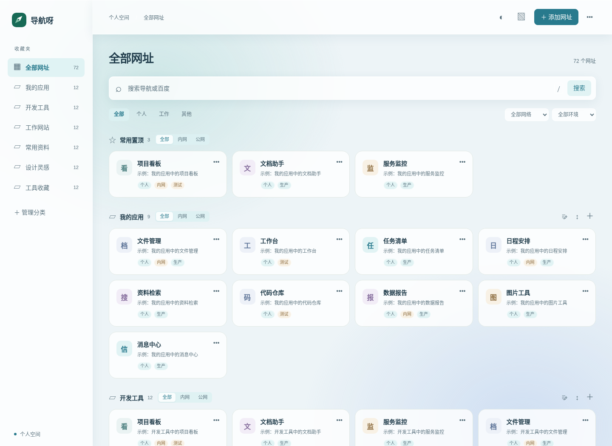

# NavSprout · 导航呀

**A private, self-hosted launchpad for your links and AI-built apps.**

一个轻量的个人导航站：集中收藏网站、管理自建应用，让 AI 在部署结束后自动登记访问地址。



- 中文界面，适配手机、桌面及 21:9 / 32:9 超宽屏。
- 分类收藏、中文搜索、置顶、拖动排序与批量编辑。
- 同一搜索框提供本地导航与百度检索候选。
- 11 种主题、不同材质和背景动效，每天定时从网络获取新背景。
- 单账号登录、服务端会话、独立 API 令牌；不开注册。
- 稳定 key 的幂等登记 API，配套可迁移的 AI Skill。
- SQLite 持久化、JSON 导入导出、一致性备份；Docker Compose 单应用部署。

FastAPI + SQLite + 原生 HTML/CSS/JS，无前端构建步骤，无外部字体依赖。仓库不包含预置收藏或演示数据；截图为隔离测试中生成的示例。

## 快速启动

需要 Linux / NAS、Docker Compose 2.x，以及 Python 3.10+。Windows 可通过 WSL2 运行。

```bash
git clone https://github.com/LLW2026/navsprout.git
cd navsprout
python3 -m venv .venv
.venv/bin/pip install -r requirements.txt
.venv/bin/python scripts/setup.py
# 读取生成的随机密码，文件仅当前用户可读
cat "$HOME/.config/navsprout/admin-password.txt"
docker compose up -d --build
```

打开 `http://localhost:8866`，默认账号 `admin`。初始化会生成随机密码、API 令牌与会话密钥，写入受保护文件和 `.env`；已有配置不会覆盖。需要 LAN 或 HTTPS 访问时，在初始化阶段指定实际地址：

```bash
.venv/bin/python scripts/setup.py --lan-ip 192.168.1.10 --domain nav.example.com
```

这里的 IP 和域名仅为示例，部署前替换为自己的地址。首次启动可直接添加分类和网址。数据位于独立挂载的 `data/`，容器重启和重建后保留。

配置和 HTTPS 接入见 [部署说明](docs/DEPLOYMENT.md)；参数示例见 [.env.example](.env.example)。`.env` 的值使用单引号包围，以保留 Argon2id 哈希中的 `$`。

## 使用

登录后添加分类、添加网址。卡片菜单中编辑、置顶、上移、下移、删除；编辑表单也可设置排序值、归属、网络和环境。卡片右下角 ⠿ 可用鼠标拖动排序，拖入其他分类会移动分类；分类侧栏和管理列表也支持拖动。

同一分类中打开「批量编辑」，勾选至少两个网址，选择「聚合为卡片」并填写名称。点击聚合卡展开地址；卡片菜单可编辑成员、调整顺序、置顶、移动整组或拆分。仅支持一层，成员保留原网址与固定标识，自动登记可继续更新。单个成员移动分类会自动移出聚合。

全局「全部按名称排序」位于右上角三个点的「设置」菜单中。每个分类标题右侧「＋」旁有批量编辑和按名称排序图标；分类排序只整理该分类，中文名称和数字采用自然顺序。筛选后仍处理完整分类内容，排序保留置顶、图标和记录标识。

批量编辑窗口支持勾选网址修改名称、网址、说明，并可多选移动分类、置顶、取消置顶和删除。删除需要确认；一次操作在数据库事务中整体保存，参数出错时整体回滚。分类管理支持改名、排序和删除；有内容的分类必须选择迁入分类。名称、说明按纯文本显示。

桌面卡片根据宽度自动增减列数，21:9 使用更宽的内容区域，超宽屏采用两列分类、置顶区域横跨两列；搜索区域保持适合输入的宽度。兼顾 320／390 像素手机和 2560、3440、3840、5120 像素宽屏。

右上角 ◐ 向左展开主题选项，点选立即生效，页面可继续操作。提供 11 种主题和跟随系统。新增晨光磨砂、手作纸笺、流动极光、日落奶油、荧光终端，分别采用磨砂玻璃、纸张纹理、极光渐变、柔和浮起和终端网格等效果，标签质感也随主题变化；偏好保存在当前浏览器，刷新保留、标签页同步。

主题面板下方「卡片透明度」滑动条支持 0%–100%，即时调整普通卡片和聚合卡片的背景，文字、图标保持清晰。首次沿用主题原有材质；手动设置后刷新保留、同浏览器标签页同步，切换主题继续沿用。

右上角 ▧ → 图片 →「每日新图」启用网络背景。服务器默认每天北京时间 **06:00** 从免费 Lorem Picsum／Unsplash 图库取得新图片，避开最近 30 张已用图片，保存至独立数据目录；无需打开网页触发。页面每分钟检查新记录并自动换图，支持已缓存图片轮播和手动换图。关闭「背景动效」可停用背景动画；系统减少动态效果设置优先。图源失败会保留旧图、定时重试，内置 8 张风景图仅作备用。 图片使用原生高清横图（至少 4K，最高 5000 像素宽）；「遮罩」可选择半透明或无遮罩，立即生效并记住选择。

可在 `.env` 设置 `NAV_BACKGROUND_REFRESH_TIME=06:00` 调整每日时间，`NAV_BACKGROUND_ENABLED=true` 开启后台更新。运行时图片由服务器统一获取并同域展示，无需图源账号或 API 密钥。照片来自图库，指每天选择新图，并非承诺当天拍摄或上传。详见 [背景图源与维护](docs/BACKGROUNDS.md)。

输入时实时匹配导航的名称、说明和网址，候选框用 ▦ 与“百”区分导航和百度。回车默认查看本地结果；本地没有匹配时默认百度，也可点击候选项或用上下方向键选择。百度结果在新标签页打开，输入过程不会向百度发送请求。按 `/` 聚焦搜索框。

含内外网入口的分类标题旁提供“全部／内网／公网”，各分类独立筛选，并与页面顶部的筛选条件叠加。

卡片优先使用手动图标；未设置时加载网站 favicon，获取不到时显示名称首字。服务端仅下载小型 ICO/PNG/GIF/JPEG/WebP 图标，不转发浏览器 Cookie 或令牌；缓存位于 `data/favicon-cache/`，成功缓存 7 天、失败缓存 1 小时，删除该目录可重新获取。远程 SVG 不作为站点图片转发。导航自身提供 SVG、ICO 及手机触屏图标。

页面右上菜单导入或导出 JSON。删除网址需要确认；导入会明确提示按固定标识合并及覆盖展示字段。空分类保留添加入口。浏览器仅持有不透明会话 ID，导航数据统一存入服务器数据库。

## AI 自动登记

将 `skills/nav-manager/` 复制到 AI 的技能目录，或直接运行其中的 Python 脚本。凭据从受保护配置或环境变量注入：

```bash
set -a
. "$HOME/.config/navsprout/nav-manager.env"
set +a
python3 skills/nav-manager/scripts/nav.py upsert \
  --key "$PROJECT_ENV_KEY" --name "$APP_NAME" \
  --url "$DEPLOYED_URL" --category '我的应用'
```

`DEPLOYED_URL` 必须来自部署完成后的实际访问地址；`PROJECT_ENV_KEY` 在同一项目环境中保持稳定。重复执行更新原记录，默认保留人工设置的分类、排序、置顶与图标。脚本自动回读确认，失败以非零退出码结束。

见 [Skill](skills/nav-manager/SKILL.md)、[部署收尾示例](skills/nav-manager/references.md) 和 [API 文档](docs/API.md)。

## 数据、备份与升级

```bash
# 在线一致性备份（使用 SQLite backup API，包含 WAL 已提交数据）
python3 scripts/database.py backup data/nav.db "backups/nav-$(date +%Y%m%d-%H%M%S).db"
# 恢复前先停止应用；恢复会清除旧会话
docker compose stop nav
python3 scripts/database.py restore backups/选定备份.db data/nav.db --app-stopped
docker compose up -d
```

操作系统权限需能读写 data。数据库备份包含私有导航，应按凭据文件一样保护。数据库备份之外，需独立保护 `.env`；不要上传到版本库。JSON 导出也可导入到另一空实例，并保留稳定标识及展示字段。

升级先备份，再拉取新源码并执行 `docker compose up -d --build`。`data/` 独立挂载，禁止用临时目录替换。数据库以 `PRAGMA user_version` 执行事务迁移，已有 v1 数据不重置；不接受高于应用支持版本的数据库。未来有不兼容结构变更时，回退镜像需配套恢复升级前备份。

## 开发与测试

```bash
.venv/bin/pip install -r requirements-dev.txt
.venv/bin/python -m pytest -q
# 可选浏览器验收：需要 Node.js 和 Chromium
npm ci
npx playwright install chromium
.venv/bin/python scripts/check_browser.py
```

浏览器验收自动启动本机临时实例，使用随机凭据和临时数据库，结束后关闭并删除；不会连接正式站点。覆盖实际排序、拖放、批量编辑、主题和背景、手机及超宽屏。

- `app/`：后端、数据库和本地前端。
- `scripts/`：初始化、备份、清单同步和浏览器验收。
- `skills/nav-manager/`：可复用的登记 Skill 与 HTTP 客户端。
- `deploy/`：Caddy / Nginx 代理模板。
- `tests/`：API、认证、持久化和浏览器测试。
- `docs/`：API、部署、图源、验收与贡献说明。

测试范围与结果见 [验证记录](docs/TESTING.md)。

## 许可

项目代码采用 [MIT](LICENSE)。内置背景照片使用各自的 Unsplash 许可，作者和作品地址见 [第三方声明](THIRD_PARTY_NOTICES.md) 与图片目录；不属于 MIT 授权范围。

欢迎提交 Issue 和 Pull Request，见 [贡献说明](CONTRIBUTING.md)。
